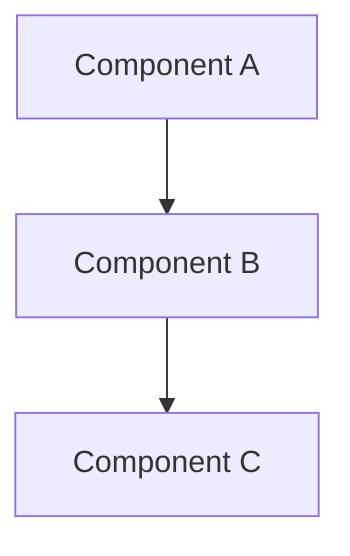
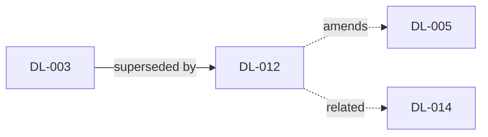

<!-- Generated by dld-kit from templates/skills/dld-snapshot/SKILL.md. Do not edit: updating the skills overwrites this file. -->

# /dld-snapshot — Generate Spec Projection

You are generating documents that project the current state of the decision log into readable formats. The built-in document is always generated:

- **`decisions/OVERVIEW.md`** — High-level narrative synthesis with Mermaid diagrams. The document you'd hand to someone who needs to understand the system.

It covers `accepted` decisions as the current state of the system, and `proposed` decisions (for example from `/dld-plan`) as planned direction, kept in a separate section so they are never mistaken for what the system does today.

If the project's `dld.config.yaml` defines `snapshot_artifacts`, additional custom documents are generated as well (see Step 4).

## Commands

`${CLAUDE_SKILL_DIR}` is the absolute path of this skill's directory. The commands below run the `dld` CLI bundled with the dld-common skill, and need Node.js 22+. If `${CLAUDE_SKILL_DIR}/../dld-common/scripts/dld.mjs` does not exist, stop and tell the user to reinstall dld-kit's skills, including dld-common.

This skill uses: `detect-snapshot-changes`, `collect-active-decisions`, `update-snapshot-state`.

## Prerequisites

Check that `dld.config.yaml` exists at the repo root. If not, tell the user to run `/dld-init` first and stop.

There must be at least one `accepted` or `proposed` decision. If there are none, tell the user there's nothing to snapshot yet and suggest `/dld-decide` or `/dld-plan`.

Check for uncommitted changes to decision files. Run `git status --porcelain -- <decisions_dir>/records/` and inspect the output. If there are unstaged or staged-but-uncommitted decision files, commit them first with a message like `"Update decision records"` before proceeding. This ensures the change detection script can rely on git history. Tell the user you are committing pending decision changes.

### A SNAPSHOT.md from an earlier version

Earlier versions of dld-kit also generated `<decisions_dir>/SNAPSHOT.md`, a per-decision listing; it is no longer generated. If that file exists, check `snapshot_artifacts` in `dld.config.yaml` for an entry titled `SNAPSHOT.md`, compared without regard to case:

- If an entry's title matches the file's name exactly, the file is a custom artifact the user defined. Generate it in Step 4 like any other, and never offer to delete it.
- Otherwise the file is left over from an earlier version (this includes an entry titled `snapshot.md`, which writes a separate file on a case-sensitive filesystem). Tell the user that `SNAPSHOT.md` is no longer generated and will go out of date, and ask with `AskUserQuestion` whether to delete it.
  - If they agree, run `git rm <decisions_dir>/SNAPSHOT.md`, or delete the file if git doesn't track it. If `git rm` refuses because the file has uncommitted changes, tell the user and leave it; never force.
  - If they keep it, leave it untouched, and mention two ways to stop the question: define `SNAPSHOT.md` in `snapshot_artifacts` with their own prompt to have it generated again, or rename or move the file to keep its current content.
- If nobody can answer (a scheduled or CI run), leave the file untouched.

Whatever happened to the file, say so in the Step 6 summary.

## Step 1: Determine update mode

If the user's message includes `--full` (e.g., `/dld-snapshot --full`), skip change detection and use **full mode** for all documents.

Otherwise, run:

```bash
node "${CLAUDE_SKILL_DIR}/../dld-common/scripts/dld.mjs" detect-snapshot-changes
```

This outputs:
- `mode: full` — no prior snapshot state exists, or OVERVIEW.md is missing. Proceed with full generation.
- `mode: incremental` — prior state exists. The output also includes:
  - `new_decisions:` — comma-separated list of accepted and proposed decision IDs not yet in the snapshot (e.g., `DL-072, DL-073`)
  - `modified_decisions:` — comma-separated list of existing decisions changed since last snapshot (status changes, content edits, deleted records)
  - `commit_range:` — the git range since last snapshot (e.g., `abc1234..HEAD`)

If mode is `incremental` but both `new_decisions` and `modified_decisions` are empty, tell the user nothing has changed since the last snapshot and stop.

## Step 2: Collect active decisions

```bash
node "${CLAUDE_SKILL_DIR}/../dld-common/scripts/dld.mjs" collect-active-decisions --include-proposed
```

This outputs the full content of all `accepted` and `proposed` decisions in ID order, separated by `===DLD_DECISION_BOUNDARY===` markers. Parse the output to extract each decision's frontmatter and body; the `status` field tells accepted and proposed decisions apart. Use the project mode from `dld.config.yaml` (already checked in prerequisites) to determine the organization strategy.

## Step 3: Generate or update OVERVIEW.md

You are **synthesizing** across decisions to create a readable narrative that explains the system's current design. Think of it as the document you'd give a new team member or use to onboard an AI agent on the project.

The narrative describes only `accepted` decisions. Proposed decisions appear only in the closing **Planned Direction** section, so the rest of the document stays an accurate account of the current system.

### Full mode

Write `decisions/OVERVIEW.md` from scratch using the template and guidelines below.

### Incremental mode

Read the existing `decisions/OVERVIEW.md`. Identify which domain sections are affected by the new and modified decisions — look at their namespaces, tags, and the topics they cover. Then:

1. **Update only the affected sections.** Rewrite each affected section to integrate new accepted decisions or remove references to superseded/deprecated ones. Leave unaffected sections untouched.
   - A new, changed or deleted proposed decision only affects the Planned Direction section.
   - A proposed decision that has been accepted moves out of Planned Direction and into the narrative of its area.
2. **Add new sections** if new decisions introduce a domain area not covered by existing sections.
3. **Update diagrams** only if the changeset affects the relationships or components they depict.
4. **Update the header** (decision count, date) and **Key Technical Choices** if any new decisions are cross-cutting.

**Maintaining appropriate abstraction:** The overview should remain a high-level narrative, not grow into a detailed specification. As you update sections, consider whether the overall document still reads as an overview. If adding new decisions makes a section too detailed or the document too long, condense older stable content to make room — summarize established decisions more aggressively to keep focus on what matters for understanding the system. If the document's section structure no longer properly organizes the content (e.g., a new cross-cutting concern spans multiple existing sections), restructure as needed — this may mean a larger rewrite of the document, which is appropriate when the system's shape has meaningfully changed.

### Template

```markdown
# System Overview

> Auto-generated narrative synthesis from N active decisions and M proposed decisions. Last updated YYYY-MM-DD.
> This document is derived from individual decision records — do not edit manually.
> Use `/dld-snapshot` to regenerate.

## Architecture Overview

<If there are enough architectural decisions to warrant it, include a high-level Mermaid diagram showing key components and their relationships. Base this on the code references and decision content.>



## <Namespace or Domain Area>

<Narrative prose synthesizing the decisions in this area. Write in present tense.
Explain what the system does and why, weaving together multiple decisions into
a coherent story. Reference decision IDs parenthetically, e.g., (DL-012).>

<If the decisions in this area describe a flow or process, include a Mermaid diagram:>

```mermaid
sequenceDiagram
    participant Client
    participant API
    participant PaymentGateway
    ...
```

<Continue with other areas...>

## Decision Relationships

<Only include this section if there are supersession chains, amendment relationships, or closely related decision groups among accepted decisions.
If no decisions supersede or amend others and there are no meaningful relationship clusters, omit this section entirely.>



## Key Technical Choices

<Bullet-point summary of the most impactful cross-cutting decisions that don't
belong to a single area. E.g., "PostgreSQL for primary data store (DL-001)",
"All API input validated with Zod schemas (DL-008)".>

## Planned Direction

> Based on proposed decisions that are not yet accepted. This describes intended changes, not the current system.

<Only include this section if there are proposed decisions. Short prose, grouped by
area or by plan tag, describing what is planned and how it would change the system
described above. Cite each decision as "(DL-NNN, proposed)". If a proposed decision
would supersede or amend an accepted one, say which.>
```

### Narrative guidelines

- **Write prose, not lists.** INDEX.md already lists every decision, and the records hold the detail. The overview should read like a design document.
- **Synthesize, don't enumerate.** Don't just list decisions — explain how they fit together. "The billing system uses banker's rounding for EU VAT calculations (DL-012), replacing the earlier truncation approach that caused reconciliation failures."
- **Use present tense.** Describe what the system *does*, not what was decided. The Planned Direction section is the exception: it describes what is intended, and never presents proposed decisions as current behaviour.
- **Reference decision IDs parenthetically.** Every claim should be traceable: "(DL-012)" after the relevant statement.
- **Include Mermaid diagrams where they add clarity.** Good candidates:
  - Architecture/component diagrams when decisions span multiple components
  - Sequence diagrams when decisions describe flows or protocols
  - Relationship diagrams when there are supersession chains or amendment relationships
  - Don't force diagrams if the decisions are simple or unrelated
- **Keep it proportional.** A project with 5 decisions needs a short overview. A project with 50 needs more structure. Scale the document to the content.
- **Group by namespace (namespaced projects) or by domain theme (flat projects).** For flat projects, identify natural domain groupings from tags and decision content.

### Diagram guidelines

When creating Mermaid diagrams:
- Use `graph TD` or `graph LR` for architecture/component/relationship diagrams
- Use `sequenceDiagram` for flow/protocol diagrams
- Use `flowchart` for process/workflow diagrams
- Keep diagrams focused — show the relationships that decisions actually govern, not a complete system map
- Label edges with the nature of the relationship
- Reference relevant decision IDs in node labels or notes where helpful
- **Always quote node labels** with `["..."]` to avoid parse errors from special characters
- **Escape `@` as `#64;`** inside node labels and edge labels — raw `@` breaks Mermaid parsing
- **Use `<br/>` for line breaks** inside quoted labels — do not use `\n` or literal newlines
- **Avoid special characters** (`(`, `)`, `[`, `]`, `{`, `}`, `|`, `#`, `&`) in unquoted labels — use quoted labels or HTML entities instead

## Step 4: Generate custom artifacts

Read the `snapshot_artifacts` key from `dld.config.yaml`. If the key is absent or the list is empty, skip this step entirely.

For each entry in `snapshot_artifacts`:

1. **Validate the `title`:**
   - Must end in `.md`. If not, warn the user and skip this artifact.
   - Must not collide (case-insensitive) with reserved filenames: `OVERVIEW.md`, `INDEX.md`. If it collides, warn the user and skip this artifact.

2. **Generate `decisions/<title>`** using the collected decisions (from Step 2) as context and the `prompt` field as the generation instruction. Accepted decisions are the current state; treat proposed ones as planned work, and if the artifact mentions them, mark them as proposed. The file must begin with this standard header:

   ```markdown
   # <Title without .md extension>

   > Auto-generated from the decision log on YYYY-MM-DD. Do not edit manually.
   > Use `/dld-snapshot` to regenerate.
   ```

   Followed by the content generated according to the prompt.

Keep track of which custom artifacts were successfully generated — you will need the list for Step 5 and Step 6.

## Step 5: Update snapshot state

Pass any successfully generated custom artifact filenames as arguments:

```bash
node "${CLAUDE_SKILL_DIR}/../dld-common/scripts/dld.mjs" update-snapshot-state [ARTIFACT_NAME...]
```

For example, if custom artifacts `ONBOARDING.md` and `API-CONTRACTS.md` were generated:

```bash
node "${CLAUDE_SKILL_DIR}/../dld-common/scripts/dld.mjs" update-snapshot-state ONBOARDING.md API-CONTRACTS.md
```

If no custom artifacts were generated, run without arguments:

```bash
node "${CLAUDE_SKILL_DIR}/../dld-common/scripts/dld.mjs" update-snapshot-state
```

## Step 6: Suggest next steps

> Snapshot generated:
> - `decisions/OVERVIEW.md` — narrative synthesis with diagrams (N active decisions, M proposed)
> - `decisions/<ARTIFACT>.md` — <one line per custom artifact generated, if any>
> - `decisions/SNAPSHOT.md` — <only if the file existed: deleted, kept (no longer generated), or generated as a custom artifact>
>
> Next steps:
> - Review the generated documents for accuracy
> - `/dld-decide` — record new decisions
> - `/dld-audit` — check for drift between decisions and code
