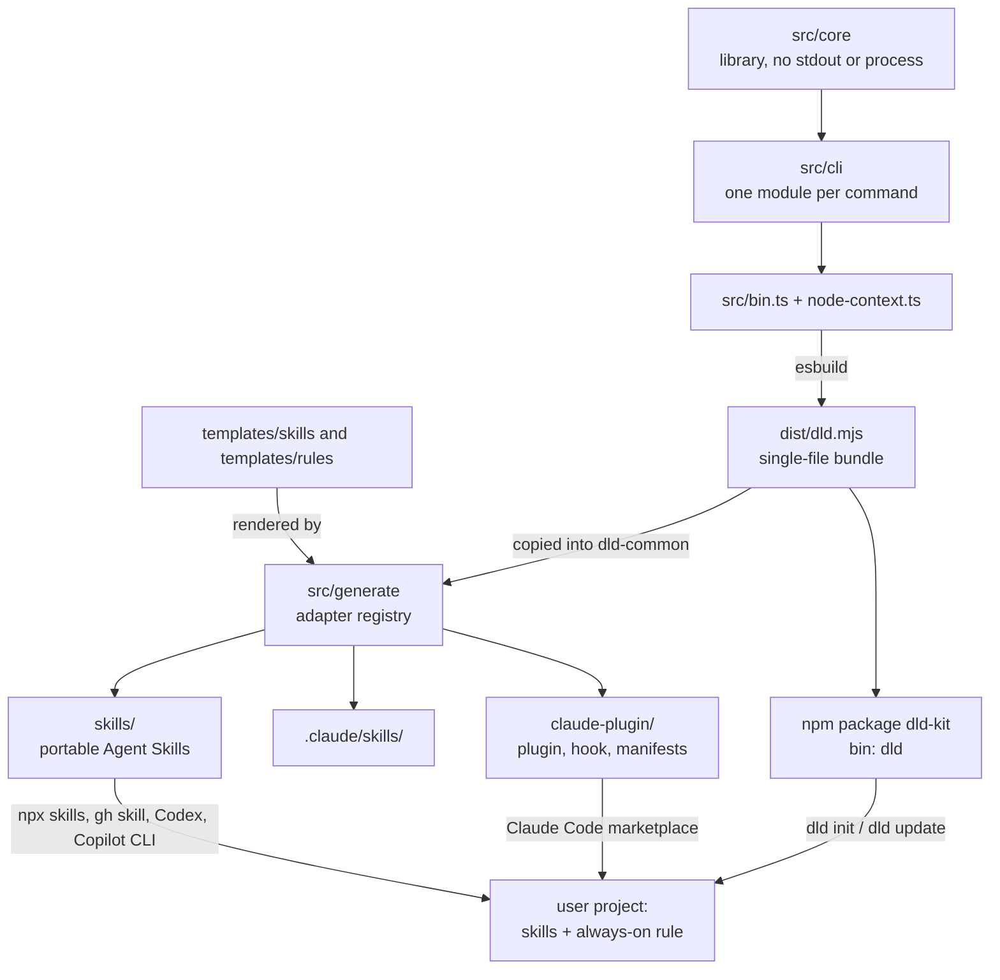
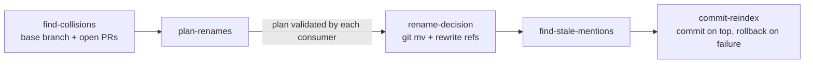
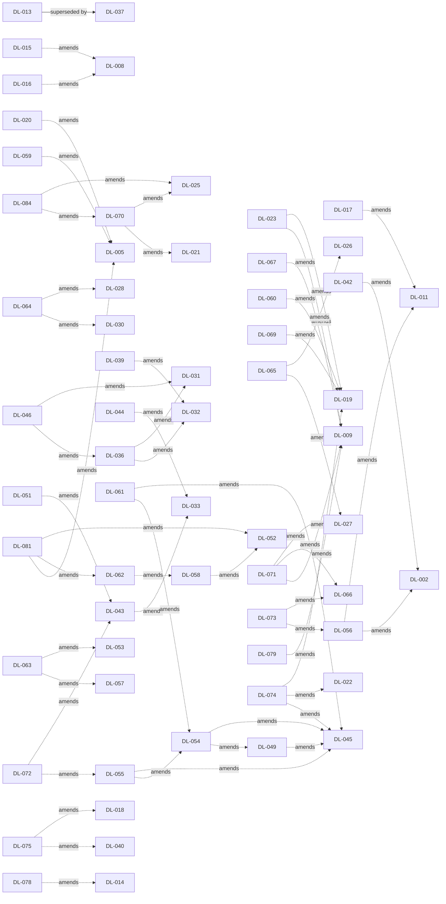

# System Overview

> Auto-generated narrative synthesis from 81 active decisions and 0 proposed decisions. Last updated 2026-11-02.
> This document is derived from individual decision records — do not edit manually.
> Use `/dld-snapshot` to regenerate.

## Architecture Overview

dld-kit is a set of agent skills for Decision-Linked Development, backed by a TypeScript CLI that performs every mechanical operation the skills need. Judgment, prose and user interaction live in the skill text; ID assignment, record edits, annotation scans, index rendering and git bookkeeping live in the CLI. Skill text is written once as templates and rendered per harness by a generator. The CLI is bundled into one file that ships inside the skills, so a skill always calls the exact CLI version it was generated with (DL-035).

## Toolchain and Build

Everything shipped runs on Node 20 or newer, compiled to ESM; Bun is only a development tool for tests and scripts, and a Node-only typecheck pass over `src/` rejects Bun APIs in shipped code (DL-001). `tsc` checks types while esbuild produces a single bundle, `dld.mjs`, which is both the npm `bin` target and the file copied into the skills, so there is only one build artifact (DL-003). Biome handles linting and formatting (DL-006).

The package is the unscoped npm package `dld-kit` with one command, `dld`, and an explicit `files` allowlist (DL-002). It also ships the skill and rule templates so that the CLI can render skills at install time (DL-042).

Testing has two layers: colocated `bun test` unit tests over library functions with injected dependencies, and CLI integration tests that run the built bundle under Node (DL-004). The bash scripts and their bats suite served as the oracle during the port and were removed after a coverage audit (DL-037). CI runs typecheck, lint, every test layer on Node 20 and 22 and a pack dry-run (DL-005), reports unit coverage on each PR with a 90% per-file floor (DL-020), and pins GitHub Actions by commit SHA at their Node 24 majors (DL-059).

## CLI and Core Library

The code splits into `src/core`, a library that never writes to stdout or touches `process`, and `src/cli`, a thin layer with one module per command (DL-007). Core reaches the filesystem, git, `gh`, standard input, the clock and a warning channel through an injected `Context`, so failure branches can be unit-tested without a real repository (DL-008, DL-015, DL-016, DL-026, DL-079). Writes that must not be seen half-finished go through a temp file and rename, and new files are created exclusively (DL-015).

Commands parse arguments with Node's built-in `parseArgs`, handle `--help` centrally (DL-017), and report errors on stderr with exit 1, usage errors with exit 2, and tolerate closed pipes (DL-012). The project root is found with `git rev-parse --show-toplevel` (DL-010), and `dld.config.yaml` is parsed with the `yaml` package into a validated config (DL-009). Keys the config does not know produce a warning with a did-you-mean hint, printed once per run; they stay warnings throughout 1.x, so later releases can add keys (DL-079). Command names began as the names of the bash scripts they replaced (DL-011). The semver contract covers the setup and CI commands (`init`, `update`, `install-rule`, `session-context` and `check-decision-edits`); the commands the skills run are internal and listed separately in `--help` (DL-056, DL-073).

## Decision Records, Index and Annotations

Records are Markdown files with YAML frontmatter. Core parses them with a real YAML parser, but edits metadata line by line so a status change touches only one line of a hand-edited file, and renders new records from a fixed template (DL-014). An ID is `DL-` plus a decimal number of at least three digits, compared by number, so the log grows past DL-999; its canonical spelling is its identity, and `create-decision` rejects any other (DL-078). IDs are unique across namespaces: creating one that exists anywhere fails, only configured namespaces are accepted, and a lookup by ID refuses to pick between duplicates (DL-080). `INDEX.md` comes from a single renderer (DL-018), and `.gitattributes` merges it with git's union driver, so two branches that both add decisions do not conflict on it (DL-075). `related-decisions` computes the reverse links the format does not store: which later decisions amend or supersede a given one (DL-077).

All annotation checks share one scanner. It walks git's file list (tracked and untracked, not ignored), skips the decisions directory and a built-in list of directories (DL-019), including agent configuration directories that hold installed skills (DL-060). It also skips files over 16 MB and unreadable files, reporting them rather than failing (DL-069). Projects exclude further paths with `annotation_exclude` git pathspecs (DL-023). `find-annotations` reports only IDs inside `@decision(...)` annotations, not plain mentions, so prose such as "replaces DL-005" is never mistaken for a code link (DL-022). An annotation is the configured prefix, one canonical ID in parentheses and nothing else; text that looks like one but is not, such as spaces or two IDs inside the parentheses, gets a warning instead of being silently ignored, and `/dld-audit` lists it (DL-074).

## Audit and Snapshot

The audit and snapshot commands keep the output formats of the scripts they replaced, with deterministic ordering (DL-024, DL-025). `find-missing-amends` lists IDs mentioned in a record's body but not declared, filtered to records changed since the last audit (DL-024). Run state lives in `.dld-state.yaml`, read with the failsafe YAML schema so short commit hashes keep their leading zeros, and updated one top-level section at a time (DL-021).

`/dld-snapshot` projects the log into `OVERVIEW.md` and any custom artifacts a project defines in `snapshot_artifacts`. A per-decision `SNAPSHOT.md` is no longer generated: it repeated the records in shortened form without applying amendments, and agents skipped it, so an existing one is offered for deletion unless a custom artifact claims the name (DL-084). Accepted decisions describe the current system, and proposed decisions are kept apart as planned direction (DL-070). `detect-snapshot-changes` compares the log with the recorded state to choose a full or incremental update. Proposed records count towards `decisions_included`, so a new plan is always picked up, and an upgrade marker lets the first run after an upgrade add proposed records an older snapshot left out (DL-025, DL-070).

## Reindex

Decision IDs are sequential, so parallel branches can collide. Reindex and the decision-edit checks compare against a base branch resolved from `base_branch` in the config, the upstream, `origin/HEAD`, `origin/main` or `main`, using only a ref that exists and failing with what it tried otherwise (DL-071). `/dld-reindex` finds local records whose IDs are taken on the base branch or in open PRs, and plans renames to free IDs (DL-027). Open PRs are scanned through `Context.gh`, and a skipped scan is always reported, because it is the one case where the user could be misled about how safe the IDs are (DL-026). A record the branch inherited from an open PR below it (by git ancestry) is not a collision with that PR, though its ID still counts as taken (DL-065).

Every command that consumes the rename plan validates all of its lines before doing any work (DL-028). Renames rewrite annotations and mentions byte for byte through the scanner's file filter, and mentions in excluded files are surfaced for the agent to judge (DL-029). The result is committed on top of the branch with literal staging and a full rollback on failure, and the branch is squashed only when the user asks (DL-030, DL-064).

## Decision Edits

A record's prose locks when the record reaches the base branch, not when it is accepted. Drafts, including records still `proposed` at the merge-base, can be edited freely, and frontmatter other than `id` and `timestamp` stays editable at all times. `check-decision-edits` detects edits to integrated records exactly, through a git diff against the merge-base (DL-066). The `decision_edits` setting decides what agents do about them: `block` (the default) records an amendment or superseding decision instead, `ask` edits after confirmation, and `allow` edits (DL-067). The always-on rule states this, and the editing skills run the check as their last step, restoring prose with `restore-decision-prose` under `block` (DL-068). The same command is a supported CI gate: it exits 3 under `block` when a pull request edits merged prose, and a `Decision-Edit: DL-NNN` commit trailer marks a deliberate fix as `allowed` (DL-073).

## Skills: Templates, Generation and the Bundled CLI

Skill content exists only in `templates/skills/`. A small placeholder syntax abstracts what differs between harnesses (DL-031): `{{dld}}` renders the CLI invocation each harness needs, and `{{dld-setup}}` checks that `dld-common` is installed (DL-036). The generator in `src/generate` renders templates through an adapter registry into an in-memory result (DL-032), and a sentence in each skill keeps it usable in harnesses that read another harness's directory (DL-046). Output carries only settings the harness reads (DL-039).

Generated output is committed and checked byte for byte, and `check:generated` fails on hand edits, missing regeneration or orphaned files (DL-033). Every generated file carries one notice that holds wherever it is installed (DL-044). Each skill set ships a single copy of the bundled CLI in `dld-common/scripts/dld.mjs`, and building happens before generating, so a stale bundle cannot be committed (DL-035). Tessl packaging and the hand-maintained skill copy were retired (DL-034), and the development docs describe the CLI-only toolkit (DL-038).

Two skill behaviours guard against acting on the wrong decision. `/dld-lookup` lists the decisions that amend or supersede the one it reads, follows chains of superseded amendments, and tells the agent to follow the newest accepted decision (DL-077). `/dld-implement` without arguments asks which proposed decisions to implement, offering only those added on the current branch by default (DL-076).

## Project Setup and the Always-On Rule

`dld init` sets up DLD in a project without an agent session: config, directories, index, skills and the always-on rule. It refuses to run twice, and `dld update` refreshes everything afterwards (DL-040). Harnesses are targeted by name (`claude`, `antigravity`, `codex`, `cursor`, `opencode`, `pi`), detected from markers in the project and confirmed interactively, or given with `--agent` (DL-041). The CLI renders the skills from its bundled templates and copies itself into `dld-common`, so installed skills match the CLI that installed them (DL-042). `update` owns dld-kit's `dld-*` directories: it overwrites and prunes them, and refuses to downgrade skills a newer version installed (DL-043). It counts a directory as dld-kit's only by a shipped skill name, or by a stamp whose generated notice names that same directory, so a user's own `dld-*` skill and an edited `.claude/CLAUDE.md` are left in place with a warning, and every removed file is named (DL-072). `init` and `update` also add the union-merge line for `INDEX.md` to `.gitattributes` (DL-075). It coexists with `npx skills` and `gh skill` installs, refusing symlinked copies it cannot safely own, and CI checks both installers (DL-051).

The always-on rule has one source, `templates/rules/dld-workflow.md`, rendered with the project's `annotation_prefix` (DL-074). It is delivered through files dld-kit owns where a harness supports them (`.claude/rules/`, `.agents/rules/`), and otherwise through a marked block in AGENTS.md or CLAUDE.md, so that each harness loads it exactly once (DL-045). Which instruction files each harness reads, and where a new block goes, follows the harnesses' documented behaviour: Cursor reads both files, OpenCode only AGENTS.md, and a new block goes where every target harness can see it (DL-054, DL-061). Claude Code gets an AGENTS.md block through a dld-kit `.claude/CLAUDE.md` import (DL-055). The dld-init skill installs the rule through the CLI, and this repository uses the same channel (DL-047).

## Distribution and Releases

Users install dld-kit through several channels. The npm package provides `dld init`. The portable `skills/` directory serves `npx skills`, `gh skill`, and Codex and Copilot CLI through an Agent Plugins manifest and their own marketplace files; Pi installs it as a package (DL-050). A Claude Code plugin is generated into `claude-plugin/` with a marketplace in the same repository (DL-048). The plugin's SessionStart hook prints the rule through `dld session-context`, unless the project already loads it, and it stays silent on failure (DL-049).

`package.json` holds the only version (DL-052). Releases go through Changesets: every pull request adds a changeset, which CI enforces, and pending changesets on `main` open a "Version Packages" pull request that bumps the version and regenerates every stamp and manifest. Merging it publishes: a read-only job checks and packs the release, a job in the `npm` environment publishes that tarball through trusted publishing without running project code, and a third creates the tag and the GitHub release from the changelog (DL-081). 1.0 is going out as release candidates from `main`, in Changesets pre mode, and 1.0.0 is released only once they run clean (DL-058). Each candidate is the default install, npm `latest` and the latest GitHub release, without manual steps (DL-062, DL-081). Pre-1.0 installs migrate with `dld update` (DL-057). The README is a short entry point organised around the install channels, with reference material under `docs/` (DL-053, DL-063).

## Decision Relationships

The densest cluster is rule delivery: DL-045's channels were refined four times as real harness behaviour was tested (DL-049, DL-054, DL-055, DL-061). The annotation scanner (DL-019) and the generator decisions (DL-031 to DL-033) also gathered amendments as the toolkit moved from a port of the bash scripts to a CLI with its own install paths. The pre-1.0 hardening decisions (DL-071 to DL-080) mostly amend earlier ones, tightening behaviour the 1.0 contract freezes, and the release process went from tags to Changesets (DL-052, DL-062, DL-081).

## Key Technical Choices

- Node 20+ for everything shipped; Bun for development only (DL-001)
- One esbuild bundle, `dld.mjs`, serves as both the npm binary and the CLI inside every skill set (DL-003, DL-035)
- Library and CLI split, with filesystem, git and clock injected through `Context` (DL-007, DL-008)
- Skills are generated from templates through per-harness adapters, committed, and drift-checked (DL-031, DL-032, DL-033)
- One annotation scanner over git's file list for every check (DL-019)
- `.dld-state.yaml` read with the failsafe schema, one section at a time (DL-021)
- The always-on rule reaches each harness exactly once, through owned files or a managed block (DL-045)
- Decision prose locks on the base branch; frontmatter stays editable (DL-066)
- `package.json` is the only version source; releases go through a Changesets Version Packages pull request and npm trusted publishing (DL-052, DL-081)
- Only the setup and CI commands are under semver; the commands the skills run are internal (DL-056, DL-073)
- Decision IDs are `DL-` plus at least three digits, compared by number, unique across namespaces (DL-078, DL-080)
