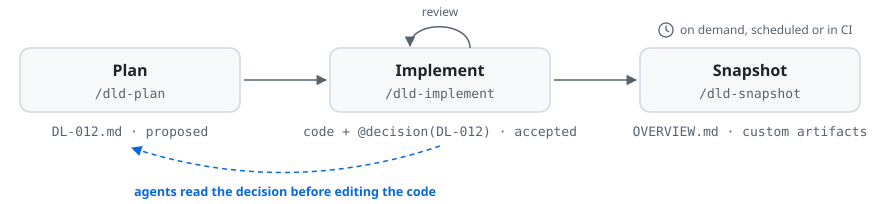

# Workflows

The examples below use Claude Code's `/dld-plan` form. In other agents, name the skill instead, e.g. "use the dld-plan skill to plan the retry feature".

Each workflow assumes DLD is set up in the repository: run `npx dld-kit init` once and commit the result, or, if you installed DLD as a plugin or with `npx skills`, run the dld-init skill once (see [install](install.md)).

## New feature or change

Use `/dld-plan` to break it down into decisions, then implement:

```
/dld-plan              # Break it down into decisions interactively
/dld-adjust DL-001     # Refine decisions if details change before implementing
/dld-implement DL-001  # Implement each decision (or batch related ones)
/dld-snapshot          # Generate overview docs from the decision log
```

For a small, isolated change (a bug fix, a single design choice), `/dld-decide` records one decision directly without the planning step.

## Existing codebase

Use `/dld-retrofit` to generate decisions from code that already exists:

```
/dld-retrofit          # Analyze code, generate decisions and annotations
/dld-snapshot          # Generate overview docs from the decision log
```

This works as a standalone "document this codebase" action. You get structured decision records, code annotations, and a generated system overview. From there you can adopt the full workflow, or just re-run `/dld-audit-auto` and `/dld-snapshot` on a schedule to keep documentation in sync.

## Working in a team

When multiple developers draft decisions in parallel, two of them can end up picking the same `DL-NNN` ID. Once one of those lands on the base branch, or shows up in an open PR, the other branch has to renumber.

```
/dld-reindex           # Renames the local draft(s) to the next free ID,
                       # rewrites @decision annotations and cross-references,
                       # and commits the renames on top of the branch
/dld-reindex squash    # Same, but squashes the branch into one commit
                       # that rebases cleanly (needs a force-push)
```

The skill checks IDs against the base branch and, when `gh` is installed and authenticated, against open PRs, so the new IDs don't collide with someone else's work in progress. Decisions your branch got from a PR it's stacked on (an implementation branch cut from a decisions PR) are not collisions.

By default the renames are a new commit, and history is left alone. Merging works: `git merge <base>`, or merging the PR with a merge commit or a squash merge. Rebasing doesn't, because the branch's earlier commits still add the old file names. If you rebase, or your repo uses "Rebase and merge", ask for a squash.

## The everyday loop

The core DLD loop: record decisions via `/dld-decide` or `/dld-plan`, implement them with `/dld-implement`, and the framework maintains tight coupling between the decision log and code through `@decision` annotations. `/dld-audit` periodically checks for drift, and `/dld-snapshot` regenerates the derived specification.

<picture>
  <source media="(prefers-color-scheme: dark)" srcset="assets/dld-workflow-dark.svg">
  
</picture>

## Hands-off

For teams that want living documentation without changing how they work. Set DLD up and run `/dld-retrofit` once to bootstrap, then schedule `/dld-audit-auto` and `/dld-snapshot` to run automatically (e.g. nightly via CI). The audit detects unreferenced code changes, infers new decisions, and back-annotates the code — all without developers invoking any DLD commands during their normal workflow.

> [!NOTE]
> DLD doesn't include a scheduler. How you trigger the automated runs is up to you — [Claude Code's built-in cron support](https://github.com/anthropics/claude-code/blob/main/CHANGELOG.md#2171), a CI pipeline step, or any other external scheduler all work.
